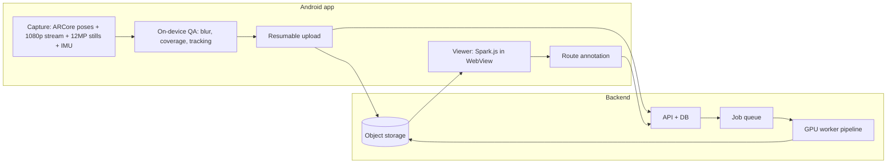

# Wall Scanner — Initial Architecture (in-house)

Status: draft v0 (2026-10-20 JST). Scope: Android capture app + GPU backend that turns a short capture of a climbing wall into
(1) a photoreal 3D splat, (2) wall surface geometry, (3) individually segmented holds, and (4) routes defined as sets of holds.

## 1. Problem shape

Properties of climbing walls that drive the design:

| Property | Consequence |
|---|---|
| Walls are piecewise planar panels (plus volumes); holds are 5–40 cm protrusions | Fit panel planes first; a hold = geometry above the plane + an image mask |
| Holds are saturated, distinct colors; routes are usually one color or tag | Color clustering is a strong, cheap route-grouping signal |
| Bouldering walls ~4–5 m tall, lead walls 12–15 m; capture distance 1–4 m | Metric scale required; drift over long sweeps must be corrected |
| Bare panels repeat (t-nut grid) | Weak features on blank panels; pose priors (ARCore) prevent mismatches |
| Glossy resin, spotlights, chalk | View-dependent appearance → splats over textured meshes for display |
| Walls are static; holds change weekly | Register each new capture to the existing wall frame; diff holds between sets |

## 2. Research landscape (what each family gives us)

| Family | Representative work (2024–2026) | Role here | License for commercial use |
|---|---|---|---|
| Classical SfM | COLMAP, GLOMAP (global SfM, "orders of magnitude faster", ECCV 2024) | Accurate pose refinement / bundle adjustment | BSD (COLMAP/GLOMAP) |
| Feed-forward geometry | VGGT, π³, MapAnything (metric, accepts poses + intrinsics as input), Depth Anything 3 | Seconds-scale poses + dense metric points; init for splat training | MapAnything code + `map-anything-apache` ckpt: Apache 2.0 · VGGT: `VGGT-1B-Commercial` (application, no military) · DA3: Base/Small/Metric-Large/Mono-Large Apache 2.0, Giant/Large CC BY-NC |
| Pose-free feed-forward splats | AnySplat (TOG 2025), YoNoSplat, 2Xplat | Instant low-fidelity preview | Check per repo |
| Per-scene optimized splats | gsplat (3DGS, MCMC densification, 2DGS rasterizer, depth/normal rendering), Faster-GS (CVPR 2026, 4.1× faster), FastGS (~100 s) | Final photoreal model | gsplat: Apache 2.0 · Inria reference 3DGS: **non-commercial — do not use** |
| Surface reconstruction | 2DGS, PGSR, 2D-SuGaR (EG 2026), TSDF fusion of rendered depth | Wall + hold meshes for picking, measuring, planes | Check per repo |
| 2D segmentation | SAM 3 (concept prompts, e.g. "climbing hold"); YOLO-seg / RF-DETR hold models; Roboflow hold datasets (mostly CC BY 4.0) | Per-image hold instance masks | SAM 3: SAM License (commercial with restrictions) · Ultralytics YOLO: AGPL — avoid or license |
| 2D→3D mask lifting | Lifting by Gaussians (WACV 2025), MUSplat (training-free, minutes), OP2GS (2026) | Multi-view consistent 3D hold instances | Check per repo |
| Climbing-specific | PointGrade (per-hold meshes, MoonBoard 2016, data unreleased), The Way Up (2D homography of planar wall), Environment-Scale Fabrication (MVS + climber video), Climbuddy (COLMAP + SAM + YOLO) | Validates the hold-as-unit model and planar-wall shortcut | n/a |

Conclusion: no single model does the job. The proven combination is **metric pose priors → refined poses + dense init → optimized splat → plane-aware hold segmentation lifted to 3D**.

## 3. System overview



## 4. Android app (Kotlin)

Target design for the backend-based pipeline. The shipped v0.1 app is an on-device variant of it (ARCore raw depth instead of uploaded frames; see §9–10 and `android/README.md`); the capture bundle below is the planned upload format.

| Module | Responsibility | Key tech |
|---|---|---|
| `capture` | ARCore session in Shared Camera mode; per-frame pose, intrinsics, timestamp, tracking state; 1920×1080 GPU stream recorded as frames/video; periodic 12 MP JPEG stills on high-end devices; raw IMU | ARCore `SharedCamera`, `Camera.getPose()`, Camera2 `ImageReader` via `setAppSurfaces()` (no `setRepeatingRequest`) |
| `guide` | Detect the vertical wall plane; overlay coverage heat-map; prompt passes (close rows, ±30° angled, wide arc, from below); reject blurry frames (Laplacian variance) | ARCore plane detection, OpenGL overlay |
| `upload` | Chunked resumable upload of a capture bundle; retry on bad gym Wi-Fi | tus or S3 multipart |
| `viewer` | Load splat (SPZ/SOG) + scene manifest; highlight holds of a route; tap-to-pick holds | WebView + Spark.js (proven in `viewer/index.html`); native renderer later if needed |
| `routes` | Create/edit routes (holds + roles: start, hand, foot, top), color, grade, setter | Room cache + API sync |

Capture bundle (one upload):

```
capture-<uuid>/
  manifest.json      # device, ARCore version, intrinsics, stream sizes, wall plane estimate
  frames/            # 1080p keyframes (JPEG)
  stills/            # 12 MP stills (JPEG), when supported
  poses.jsonl        # per image: timestamp, pose (ARCore world-from-camera, meters), tracking state
  imu.jsonl          # accelerometer + gyroscope samples
```

## 5. Backend pipeline (GPU worker)

| Stage | Input → Output | Default choice | Fallback / alternative |
|---|---|---|---|
| 1. Frame selection | bundle → 150–400 sharp, well-spread images | Blur score + pose-delta spacing + stills preferred | — |
| 2. Pose refinement | ARCore poses (metric priors) → refined poses + sparse points | MapAnything (Apache ckpt) with pose + intrinsics inputs → metric dense points | SuperPoint/LightGlue matching + COLMAP/GLOMAP bundle adjustment seeded with ARCore poses |
| 3. Wall frame | dense points → panel planes, wall coordinate frame (up = gravity from ARCore, normal = dominant plane) | RANSAC multi-plane fit | — |
| 4. Splat training | posed images + dense init → splat | gsplat, MCMC strategy, depth supervision from stage 2, 7–15k iterations | 2DGS rasterizer when surface quality matters more than appearance |
| 5. Surface | splat → wall + hold meshes | Render depth → TSDF fusion → mesh | PGSR / 2D-SuGaR if TSDF is too noisy |
| 6. Hold masks (2D) | keyframes → per-image hold instances | Fine-tuned hold segmentation model (permissive license, trained on CC BY datasets + own labels) | SAM 3 with "climbing hold" prompt (bootstraps labeling) |
| 7. Lift to 3D | masks + poses + mesh/splat → hold instances | Multi-view voting onto mesh faces / Gaussians (Lifting by Gaussians / MUSplat style), constrained to "above panel plane" | — |
| 8. Hold attributes | instances → centroid, normal, bbox, size, dominant color (CIELAB), mesh crop | Deterministic geometry + color stats | — |
| 9. Route suggestions | holds → color clusters as candidate routes | Color clustering per hold set | Setter confirms in app |
| 10. Registration & diff | new capture ↔ previous wall version | Align via wall planes + static features → same wall frame; mark holds added/removed | — |
| 11. Packaging | → SPZ/SOG splat (+ LoD), meshes (GLB), `scene.json` | Compress, upload, notify app | — |

Quality gates (fail fast, jidoka): stage 2 reprojection error, stage 3 plane residual, stage 4 held-out PSNR, stage 7 holds-per-m² sanity range.
A failed gate returns a specific recapture hint to the app (e.g. "left third under-covered").

## 6. Backend services

| Component | Choice | Notes |
|---|---|---|
| API | Python, FastAPI, uv | Auth, captures, walls, holds, routes, job status |
| DB | PostgreSQL | Relational model below; `scene.json` generated from it |
| Storage | S3-compatible object storage | Bundles, intermediate artifacts, published splats |
| Queue | SQS (or Redis-backed queue on-prem) | One job per capture; stages checkpointed to storage for resume |
| GPU worker | Container: CUDA, PyTorch, gsplat, MapAnything, COLMAP/GLOMAP, segmentation model | Single 24 GB-class GPU target (L4/4090) |

Data model:

```
Gym 1─* Wall 1─* WallVersion (one per hold set / reset date)
WallVersion 1─* Capture        (raw bundles; several may merge)
WallVersion 1─1 Reconstruction (splat, meshes, wall frame, metrics)
WallVersion 1─* Hold           (geometry, color, mesh crop, status: new|kept|removed)
WallVersion 1─* Route 1─* RouteHold (role: start|hand|foot|top, order)
```

## 7. Delivery phases

| Phase | Goal | Exit criterion |
|---|---|---|
| M0 Spike (offline) | Phone video (stock camera) → VGGT/MapAnything → gsplat → `viewer/index.html` | Scorecard ≥ 6/8 (see `CAPTURE.md` §5) on 3 routes |
| M1 Capture app | ARCore capture bundle + upload; pipeline uses pose priors | Metric scale within ±2% on reference; < 15 min capture-to-view |
| M2 Holds | Plane fit + 2D masks + 3D lifting + attributes | ≥ 95% of route holds detected as distinct instances on test walls |
| M3 Routes | Annotation, color suggestions, sharing, wall versions + diff | Setter can publish a route in < 2 min after processing |
| M4 Optimize | On-device preview (feed-forward), LoD/compression, native viewer if WebView is too slow | Smooth viewing on a mid-tier Android phone |

## 8. Risks and open questions

| Risk | Mitigation |
|---|---|
| 1080p ARCore frames too soft for small holds | 12 MP stills on high-end devices; closer capture passes; M0 measures this first |
| ARCore drift over long walls | Bundle adjustment in stage 2; loop-closing capture path (return to start) |
| License contamination (Inria 3DGS, AGPL YOLO, NC checkpoints) | Allow-list: gsplat, COLMAP/GLOMAP, MapAnything-apache, DA3 Apache variants, VGGT-Commercial; legal review of SAM License |
| Hold segmentation on unseen gyms | Own labeled set from M0–M2 captures; SAM 3-assisted labeling |
| GPU cost per capture | Faster-GS / FastGS-style training budgets; cache stages; batch overnight for full quality |
| Volumes vs holds ambiguity | Size + plane-residual thresholds; manual override in app |

## 9. Route definition types and route detection

A gym's marking system decides what "route" means for post-processing. The type is chosen on **New scan**, stored in `capture.json` and copied into `scene.json`, and selects the detection path at Finish.

| ID | Type | Physical marking | Start / finish | Hold sharing | Detection path |
|---|---|---|---|---|---|
| `mono_color` | Hold colour | One hold colour per route on a wall section (US default since the 2010s) | Start tag / placard at the base; finish = top hold, tag, or top-out | None; volumes usually on for all | Colour grouping (current `RouteGrouper`) |
| `color_taped` | Hold colour, taped start and finish | One hold colour per route; tape on the start hold(s) and the finish hold (common in Japanese gyms) | Taped start and finish holds; grade often on the start tape | None | Colour grouping (as `mono_color`); start / finish roles from tape detection in keyframes later |
| `tape` | Tape | Tape strip beside each hold; tape colour = route, hold colours mixed | Two strips / "start" label; taped bracket at the top; grade on the start tape | Yes, one hold on several routes | Tape detection in keyframes → holds grouped by tape colour |
| `circuit` | Circuit | Hold (or tape) colour = grade band; several problems share a colour (FR/UK gyms, Bouldering Project) | Ribbon, start marker or number per problem | Within a colour, separated only by position | Colour grouping, split by position (`MAX_ROUTE_HOLD_GAP`), later by start markers |
| `tagged` | Tagged | Placard with number, grade, setter (sometimes QR) at the base; holds by colour | Placard marks the start | As `mono_color` | Colour grouping + placard OCR/QR for grade, setter, start |
| `comp` | Competition | Tape marks start hands/feet, zone(s), top | Explicit start, zone, top | None | Tape detection with role classification |
| `free` | Free / spray wall | No set routes; dense mixed holds; climbers define problems (Stōkt-style) | Chosen by the climber | Every hold, any number of problems | No automatic routes; manual editing in the viewer |
| `board` | System board | Fixed layout lit by LEDs (Kilter, MoonBoard, Tension); colour = role | Lit start / hand / foot / finish | Full sharing | No detection; layout known |
| `outdoor` | Outdoor rock | Boulder or route on natural rock: no colour, tape or placards; the line comes from a guidebook / topo | Sit or stand start on named features; top-out or anchor | Every feature, any number of lines | No automatic routes; the line is marked by hand in the viewer. Processing differs: coarse reference plane (`OUTDOOR_PLANE_INLIER_DIST`, slabs allowed by `OUTDOOR_MAX_WALL_NORMAL_Y`) and hold relief measured against the local rock surface (`OUTDOOR_RELIEF_CELL` median grid) instead of the plane |

Rule modifiers (stored in `definition.rules`, orthogonal to the type): feet policy (`follow` = feet follow hands, `open`, `chips` = foot chips only), volumes on/off, start rule (matched, two-hand, hand+foot), finish rule (match top, touch tag, top-out), hold roles and eliminates.

### scene.json v3 schema additions

```
definition: { type: <id above>, rules: { feet: follow|open|chips, volumesOn: bool } }
holds[]:    { ..., routeId: <primary or -1>, routeIds: [..], role: any|start|hand|foot|zone|finish,
              tape: [r, g, b] | null,           colour of the start tape from this hold to its placard (the gym's grade colour)
              outline: [[u, v], ...] }          closed polygon in the wall plane: segmented on the orthophoto when there is
                                                 one, else traced from the hold's relief cells; voxels: 0 marks an image-only hold (photo search, colour split, or added by hand in the viewer)
wall:       { origin, normal, up, right, inliers, color: [r, g, b], extent: [minU, minV, maxU, maxV],
              photo: { file: "wall.png", bounds: [minU, minV, maxU, maxV], px } }
                                                 color = mean surface colour; extent = scanned area (1st..99th percentile);
                                                 photo = orthophoto from the keyframes (px metres per pixel, top row = maxV), absent when none
routes[]:   { id, name, color, grade, gradeSystem: yds|kyu_dan|v|font|null, holdIds: [..], confirmed: bool }   # a hold may appear in several routes
nextRouteId: int   # kept by the viewer so a deleted route's id is never reissued (sends.json keys by route id)
```

`capture.json` (written at New scan, before any data): `{ version, createdAt, location, set, definition, gps? }` where `location` is a `locations.json` id (empty for captures made before locations existed; assignable later from the capture list), `set` the id of the gym set the wall was scanned in (empty outdoors or when scanned without one) and `gps` is `{ lat, lon, accuracyM, at }`, recorded when the scan requested a position fix.

### Keyframes for image-based detection

The depth cloud cannot resolve tape (≈ 2 cm wide) or placard text, so the scanner saves sparse colour keyframes during the scan: `frames/frame-NNNN.jpg` (1080p, every ≥ 0.7 s when the camera moved ≥ 0.25 m or turned ≥ 15°) and `frames.jsonl` (segment id, segment-local pose, intrinsics). At Finish, after segment snapping, `frames.json` resolves every frame to a world-from-camera pose, so a pixel detection can be lifted onto the wall plane by ray–plane intersection and matched to holds by (u, v).

Detection stages (prototyped in `tools/tape.py`, to be ported on-device once validated):
1. Tape candidates per keyframe: saturated, thin, elongated blobs (HSV threshold, connected components, aspect ratio and area limits), excluding pixels inside projected hold footprints.
2. Lift each candidate centroid to the wall plane; cluster across frames (2 cm cells); keep clusters seen in ≥ 2 frames.
3. Assign clusters to the nearest hold within `TAPE_HOLD_RADIUS`; group holds by tape hue → routes (`tape`, `comp`); tape pairs / labelled tape → `start`, bracket at the top → `finish`.
4. Placards (`tagged`, `mono_color`): bright rectangular regions near the wall base; OCR (ML Kit on-device, Tesseract offline) for grade and number; QR via ML Kit barcode.

## 10. Locations, captures, routes and sends (v0.1 data)

```
Location 1─* Capture 1─* Route 1─* Send
```

A **location** (`files/locations.json`: `{ version, nextId, locations: [{ id, name, kind: gym|outdoor, gradeSystem, coords?, sets: [{ id, name, createdAt, retiredAt? }] }] }`) is a gym or an outdoor area; it is picked or registered at New scan (and stored in `capture.json`), or added from the Logbook without scanning. `coords` (`{ lat, lon, accuracyM, at }`) is filled by scans made there: a location without coordinates makes the scan ask for location permission and take fixes from the network and GPS providers (`scan/GpsFix.kt`); each fix is written to that capture's `gps`, and the location keeps the most accurate device fix (`accuracyM` 0 marks a hand-entered position, which is never replaced). `nextId` in `locations.json` only grows, so a deleted location's id is never reissued. Locations are listed in the Logbook (tap one for its routes) and edited from the header there: name, kind, grade scale, coordinates (typed as decimal degrees, stored with `accuracyM` 0, or taken from the phone with its accuracy) and delete, which leaves captures pointing at the removed id as "No location". It is the v0.1 stand-in for `Gym` in the §6 data model. A gym's **sets** ("October Set": the routes on the wall between two resets) are the stand-in for `WallVersion`: New scan at a gym asks for the set (the last used one is preselected, else the newest open one; **New set…** opens one named after the month, unique among the open sets), the id goes into `capture.json`, the Logbook groups a gym's routes by set (open sets first, retired ones after, routes outside every set under "No set"), and a set header's **Edit** renames or retires it (`retiredAt`); retiring keeps its routes and sends, and an empty set still gets a header so it can be retired. Set location on a capture offers its own set even when retired. Outdoor areas have no sets. `Wall` is not modelled, so a route still lives with the capture it was identified in.

A capture is the identification workspace: its viewer edits holds, routes and roles and ends with **Confirm** per route. Confirmed routes are the records the app lists in **Logbook** mode, grouped by location, and only they take send data, which lives beside the capture in `sends.json` (`{ version, sends: [{ id, routeId, at, result: flash|send|attempt, attempts, note }], ratings: { "<routeId>": 0..5 } }`; a rating is the climber's optional 0–5 stars for the route) so that re-editing the identification never touches the log. Earlier `scene.sends` entries are migrated into `sends.json` on first read.

Grades are chosen from a scale (`core/GradeSystem.kt`): YDS (5.5–5.15d), Japanese Q/D (10Q … 1Q, 1D … 6D), V-scale (VB–V17) or Font (3–9A). A location carries its default scale (`locations.json`, `gradeSystem`), the viewer lists that scale first and stores the choice per route as `grade` + `gradeSystem`.

## TODO

- TODO: Confirm minimum supported Android devices (ARCore + Shared Camera + 12 MP still support).
- TODO: Legal review of SAM License and VGGT-Commercial terms before shipping.
- TODO: Decide on-prem GPU vs cloud for M0–M1.
- TODO: Validate tape detection thresholds on real keyframes; port `tools/tape.py` to Kotlin.
- TODO: Placard OCR/QR (ML Kit) for `tagged` walls.
- TODO: Outdoor: validate the local-relief grid on a real boulder (ARCore depth in sunlight, ground and vegetation in front of the face); multi-face boulders still get one reference plane, so the thumbnail and (u, v) layout follow the dominant face.

## Sources

- MapAnything: https://github.com/facebookresearch/map-anything · https://arxiv.org/pdf/2509.13414
- VGGT: https://github.com/facebookresearch/vggt
- Depth Anything 3: https://github.com/ByteDance-Seed/Depth-Anything-3 · https://arxiv.org/pdf/2511.10647
- Feed-forward review: https://arxiv.org/pdf/2507.08448
- AnySplat: https://huggingface.co/papers/2505.23716
- GLOMAP: https://arxiv.org/abs/2407.20219v1
- gsplat: https://github.com/nerfstudio-project/gsplat · https://docs.gsplat.studio/main/apis/rasterization.html
- Faster-GS (CVPR 2026): https://openaccess.thecvf.com/content/CVPR2026/papers/Hahlbohm_Faster-GS_Analyzing_and_Improving_Gaussian_Splatting_Optimization_CVPR_2026_paper.pdf
- 2DGS: https://arxiv.org/pdf/2403.17888 · 2D Triangle Splatting: https://arxiv.org/pdf/2506.18575
- SAM 3: https://docs.ultralytics.com/models/sam-3 · license: https://huggingface.co/facebook/sam3/blob/main/LICENSE
- Mask lifting: https://openaccess.thecvf.com/content/WACV2025/supplemental/Chacko_Lifting_by_Gaussians_WACV_2025_supplemental.pdf · https://www.emergentmind.com/topics/musplat · https://www.alphaxiv.org/abs/2605.20044
- Inria 3DGS license note: https://cdn.jsdelivr.net/npm/gsplat@1.2.9/README.md
- ARCore shared camera: https://developers.google.com/ar/develop/java/camera-sharing
- PointGrade: https://arxiv.org/abs/2609.17770 · The Way Up: https://arxiv.org/pdf/2505.12854
- Environment-Scale Fabrication: https://web.ics.purdue.edu/~cmousas/papers/conf17-CHI.pdf
- Climbuddy: https://www.webgpu.com/showcase/climbuddy-3d-climbing-wall-photogrammetry-webgl/
